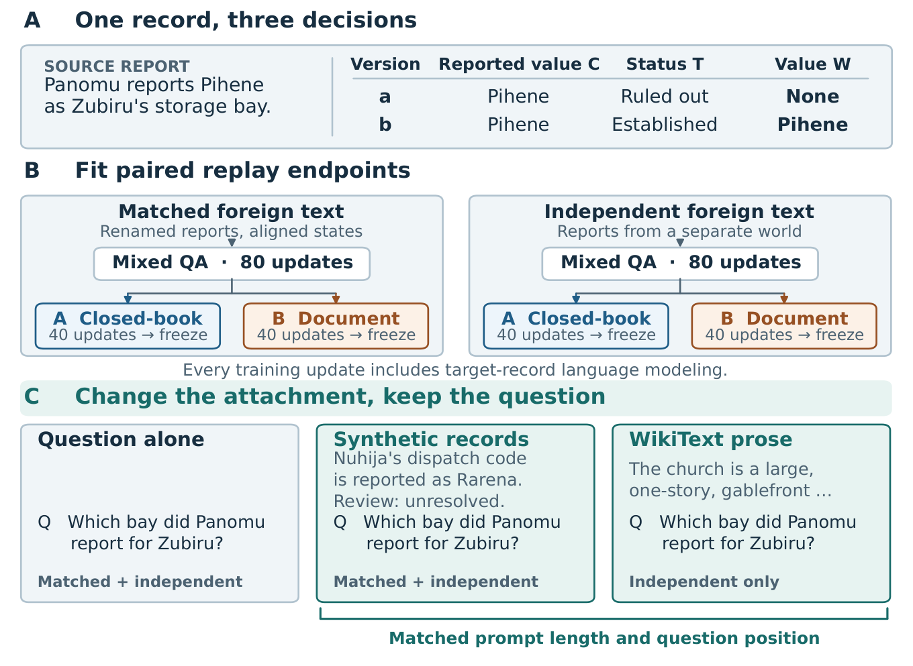

# When Does Document Replay Help Evidence-State Question Answering?

**Wenzhang Du** · [Open Research Reports](https://dqswordman.github.io/open-research/) · November 2026

On 32 paired worlds, document replay leads closed-book replay by 19.25 percentage points with synthetic attachments and trails by 7.92 points with WikiText. Sixteen fresh worlds preserve both directions.

[Manuscript PDF](paper/manuscript.pdf) · [Technical report](https://dqswordman.github.io/technical-reports/document-replay-evidence-qa/) · [中文技术报告](https://dqswordman.github.io/zh/technical-reports/document-replay-evidence-qa/) · [Interactive explorer](https://huggingface.co/spaces/DQSWORDMAN/document-replay-evidence-qa) · [Download v1.0.1](https://github.com/dqswordman/document-replay-evidence-qa/releases/tag/v1.0.1)



## Read the evidence

Adapters replay the same questions with or without supporting documents. Switching the unrelated attachment at test time reverses which specialist leads. The evaluation uses a single 1.7B backbone, synthetic inventory worlds and multiple-choice readouts. The mixed continuation matches updates and supervised answers while reading different token counts.

| Result | Open the evidence |
| --- | --- |
| Original synthetic and WikiText specialists | [Frozen records](results/original_natural_effects.csv) · [Analysis or reference](results/original_wikitext/per_parent_metrics.csv) |
| Same-fact, mixed and fresh-world studies | [Frozen records](results/bridge_query_scores.csv.xz) · [Analysis or reference](reference/paper_comparisons.csv) |
| Paired uncertainty and study coverage | [Frozen records](results/paired_effects.csv) · [Analysis or reference](reference/comparison_checks.json) |

## Reproduce on CPU

From the extracted release, run the following with Python 3.12. Results go into an empty directory of your choice.

```sh
python -m pip install -r requirements.txt
python -B verify_manifest.py
python -B reproduce.py --out replay
```

For one worked example, run `python -B example.py`. The [reproduction guide](docs/reproduction.md) maps files to scientific claims. Both technical reports are available offline in [English](docs/report.en.md) and [中文](docs/report.zh.md).

## Method implementation

The [mixed-context scheduler](code/mixed_schedule.py) and [adapter and optimizer](code/adapter_optimizer.py) expose the original branch-balancing rules and parameter updates. The CPU check reads every released mixed schedule and verifies step identities, prompt-context counts and all saved mixed and fresh-world step losses. The optional optimizer module uses PyTorch. The scientific CPU checks use NumPy and the standard library.

```sh
python -B check_methods.py
```

## Cite and reuse

Wenzhang Du (2026). *When Does Document Replay Help Evidence-State Question Answering?*. Open Research Reports, v1.0.1. [Manuscript](https://dqswordman.github.io/assets/reports/document-replay-evidence-qa/manuscript.pdf). [Machine-readable citation](CITATION.cff) · [BibTeX](citation.bib)

Wenzhang Du is the sole author. The attached PDF preserves the supplied anonymous title page. Original software uses the [MIT License](LICENSE). The author’s original report, figures, constructed data and measurements use [CC BY 4.0](licenses/CC-BY-4.0.txt). Third-party material retains its own terms and attribution. [Source notices](THIRD_PARTY_NOTICES.md)
