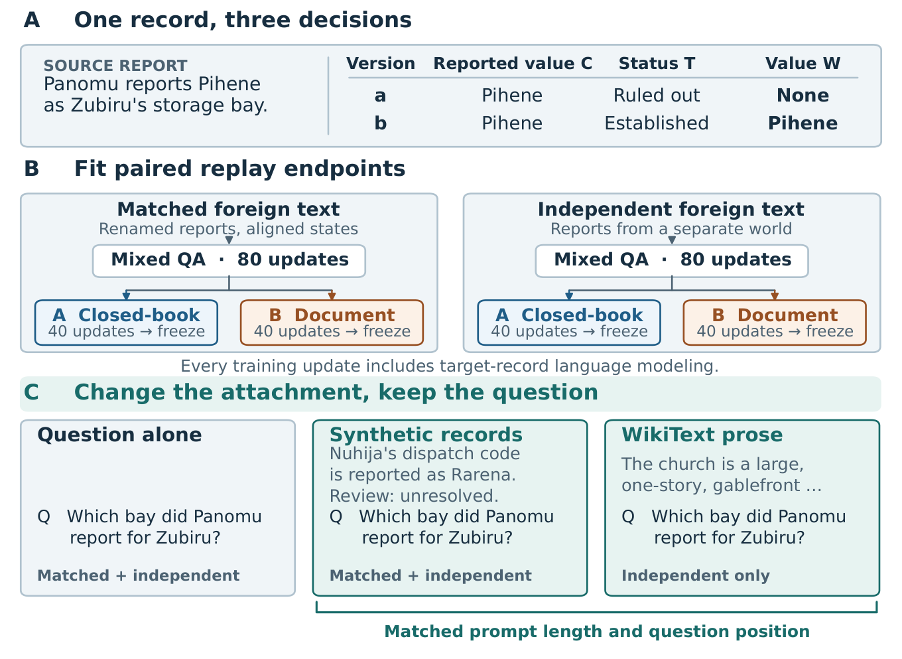

# When should practice questions keep their documents?

When Does Document Replay Help Evidence-State Question Answering?

Wenzhang Du · Open Research Reports · v1.0.0 · 2026-11-21

Adapters replay the same questions with or without supporting documents. Switching the unrelated attachment at test time reverses which specialist leads.

[Original PDF](../paper/manuscript.pdf) · [Online report](https://dqswordman.github.io/technical-reports/document-replay-evidence-qa/)

## What did the inventory say, and what can be entered?

An inventory records Pihene as Zubiru’s storage bay. An audit later rules out that assignment. Asked what the inventory reported, the answer remains Pihene. Asked what to enter in a verified catalogue, the value must remain unspecified. Scoring just the first answer would miss whether the system respected the audit.



Figure 1 traces one inventory fact through the three questions and the two replay policies.

## Change the attachment while keeping the questions paired

Both specialists start from the same mixed-practice checkpoint and receive 40 further updates on the same questions and answers. A rehearses closed book; B retains documents. At test time an attachment can be an unrelated synthetic verification record or a length-matched WikiText excerpt. Joint accuracy requires three correct readouts for one fact: the reported value, its verification state and the value permitted by that state.

A third branch continues mixed practice. It matches the number of updates and supervised answers. Its later training mix and token count differ. The paired world is the uncertainty unit. The original specialist comparison uses 32 worlds; a fresh study trains new adapters on 16 new worlds.

## The better specialist depends on the test document

On the original 32 worlds, B exceeds A by 19.25 percentage points with synthetic records. With WikiText, the difference is −7.92 points; its paired 95% interval is −12.53 to −3.55. The new-world comparison preserves both directions. On the original worlds, continued mixed practice also beats the stronger specialist on both attachment types.

Paired joint-accuracy differences, in percentage points. Positive B−A favors document replay.

| Comparison | Worlds | Synthetic | WikiText |
| --- | --- | --- | --- |
| B − A | 32 | +19.25 | −7.92 |
| B − A | 16 | +17.16 | −6.89 |
| MIX120 − stronger specialist | 32 | +5.58 | +9.23 |

[Source table](https://github.com/dqswordman/document-replay-evidence-qa/blob/v1.0.0/reference/paper_comparisons.csv)

## Keep the donor facts and rewrite their presentation

Rewriting the same synthetic donor facts as prose under explicit verdict cues narrows B’s advantage by 3.20 points. All four combinations of form and review cue still favor B. The larger WikiText reversal therefore cannot be assigned to prose formatting alone from this comparison.

The experiments use one Qwen3-1.7B backbone, synthetic worlds and multiple-choice outputs. Length matching leaves differences in vocabulary, discourse and familiarity. Real catalogues also require open-ended answers, source credibility and a cost model for incorrect entries. Those decisions lie beyond these readouts.

## Reconstruct the result on CPU

The public package stores individual choices, world-level scores, frozen question plans and source attribution. CPU replay checks 435,456 readouts in the three follow-up studies, verifies 472 paired effects and writes 17 comparisons. Earlier synthetic analyses and the original WikiText comparison are identified separately in the result map.

```sh
python -B verify_manifest.py
python -B reproduce.py --out replay
```

## Citation and materials

[Original manuscript · PDF](https://dqswordman.github.io/assets/reports/document-replay-evidence-qa/manuscript.pdf) · [Frozen release and checksums](https://github.com/dqswordman/document-replay-evidence-qa/releases/tag/v1.0.0) · [Result map and reproduction scope](https://github.com/dqswordman/document-replay-evidence-qa/blob/v1.0.0/docs/reproduction.md) · [Interactive evidence explorer](https://huggingface.co/spaces/DQSWORDMAN/document-replay-evidence-qa)
