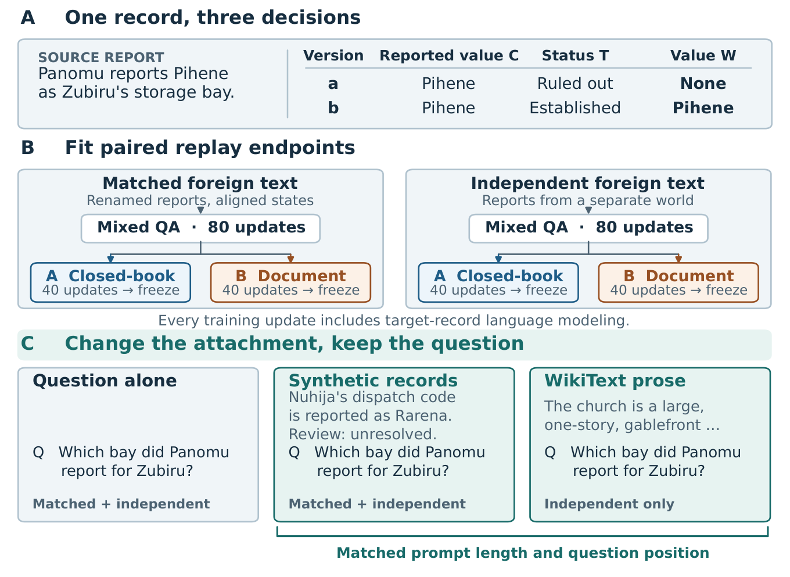

# 复习问答时保留文档，什么时候有用？

When Does Document Replay Help Evidence-State Question Answering?

Wenzhang Du · 开放研究报告 · v1.0.2 · 2026-11-22

两个适配器复习同样的问题和答案，其中一个同时阅读文档，另一个闭卷。在 32 个配对库存世界上，测试时附上无关的合成核验记录，带文档训练的一组在联合正确率上领先 19.25 个百分点。换成长度匹配的 WikiText 节选，它落后 7.92 个百分点。在 16 个新世界上重新训练后，也观察到了这一翻转。

[原版 PDF](../paper/manuscript.pdf) · [在线报告](https://dqswordman.github.io/zh/technical-reports/document-replay-evidence-qa/)

## 原记录写了什么，核验后又能填什么？

Zubiru 的库存记录把储位写成 Pihene，审计随后排除了这项归属。问原记录写了什么，仍应答 Pihene。问经过核验的目录该填什么，储位应留作未确定。还有一问直接考查核验状态。针对同一事实的三问全部答对，才记为一次联合正确。



图 1。顺着一项有争议的储位记录读三道题。两个训练分支复习同样的答案，只有一个分支同时看到支持文档。

## 固定复习答案，再替换测试附件

两个专门化分支从同一个混合练习检查点开始，用完全相同的问答再更新 40 次。A 分支闭卷，B 分支复习时保留文档。测试时两者都可能收到一份无关的合成核验记录，或一段与之长度匹配的 WikiText。联合正确率按事实统计，三问全对才计入分子。

第三个分支继续混合练习，更新次数与监督答案数相同，后段训练内容和 token 数量有所差异。区间以配对世界为统计单位。原专门分支比较使用 32 个世界，独立复验在 16 个新世界上重新训练适配器。

## 只换测试附件，两种专门化训练的领先顺序便翻转

在最初 32 个世界上，附合成材料时，带文档复习领先闭卷复习 19.25 个百分点。附 WikiText 时它落后 7.92 个百分点，按“带文档减闭卷”计算的配对 95% 区间为 −12.53 至 −3.55。在 16 个新世界上，两种附件下的差值方向都得到复现。回到最初的世界，继续混合练习的第三种适配器在两类附件上都超过了各自表现更好的专门化分支。

在同一世界内配对的联合正确率差值，单位为百分点。B−A 是带文档复习减闭卷复习。末行分别在每类附件上，用混合续训与该条件下较好的专门化分支比较。

| 比较 | 世界数 | 合成附件 | WikiText 附件 |
| --- | --- | --- | --- |
| B − A | 32 | +19.25 | −7.92 |
| B − A | 16 | +17.16 | −6.89 |
| MIX120 − stronger specialist | 32 | +5.58 | +9.23 |

[数据来源](https://github.com/dqswordman/document-replay-evidence-qa/blob/v1.0.1/reference/paper_comparisons.csv)

## 只改写法，能解释多少差异？

保留原来的事实，只把合成记录改写成散文。在明确提示核验结论时，这一改动使带文档分支的优势缩小 3.20 个百分点。呈现形式与核验提示交叉得到的四种条件仍全部有利于带文档分支。改写这些事实能解释一部分优势变化，尚不足以解释换用 WikiText 后的逆转。

实验使用一个 Qwen3-1.7B 基座、合成世界和选项式输出。长度匹配后，词汇、篇章结构和熟悉度依然可能不同。真实目录还要处理开放回答、来源可信度以及错误录入的成本，这些问题超出了本实验的读出范围。

## 从逐题选择复算联合正确率

发布包保存逐题选择、每个世界的分数、固定题目方案与资料出处。CPU 回放核对三个后续研究的 435,456 项选择、验证 472 项配对效应，输出 17 项比较。结果索引另行列出早期合成分析和最初 WikiText 比较的归档依据。

训练调度记录覆盖 32 个世界，每个世界核对 1,440 个混合练习槽位。用文档损失和问答损失重组，还能核验混合续训与新世界研究的全部 7,680 条训练步骤目标。包内提供了适配器和 Adam 实现。

```sh
python -B verify_manifest.py
python -B reproduce.py --out replay
python -B check_methods.py
```

## 引用与材料

[原版论文 · PDF](https://dqswordman.github.io/assets/reports/document-replay-evidence-qa/manuscript.pdf) · [固定版本与校验值](https://github.com/dqswordman/document-replay-evidence-qa/releases/tag/v1.0.1) · [结果映射与复现范围](https://github.com/dqswordman/document-replay-evidence-qa/blob/v1.0.1/docs/reproduction.md) · [交互式证据浏览](https://huggingface.co/spaces/DQSWORDMAN/document-replay-evidence-qa) · [方法源码与核验说明](https://github.com/dqswordman/document-replay-evidence-qa/blob/v1.0.1/docs/methods.md)
